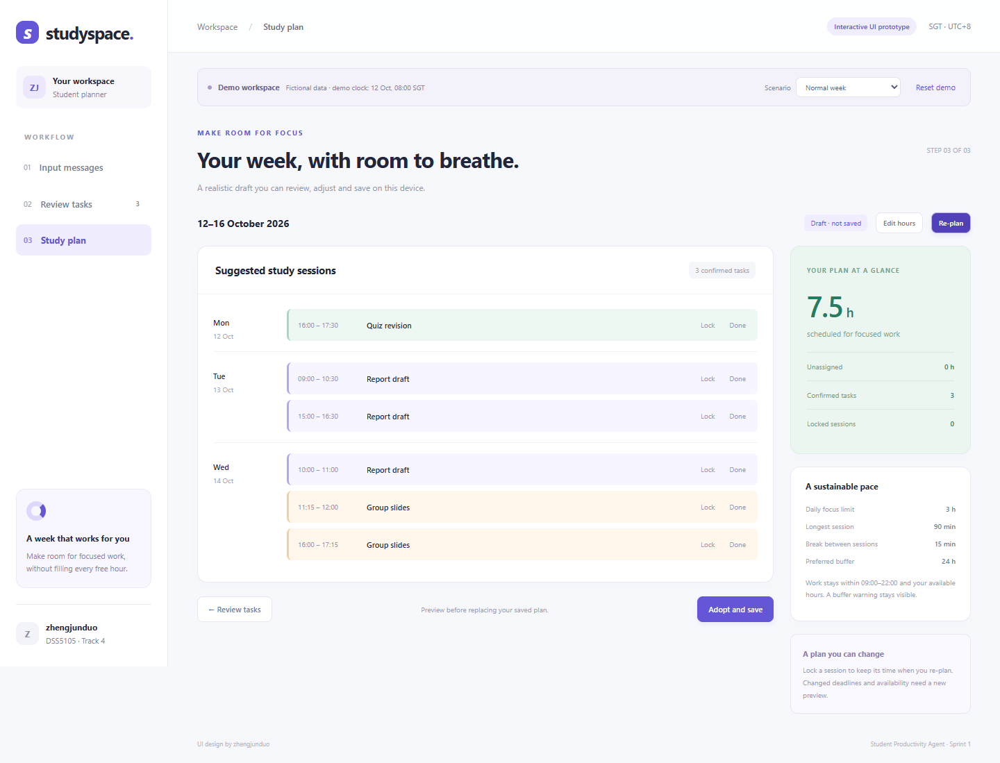

# Studyspace: Student Interface

**DSS5105 Track 4 — Student Productivity Agent**  
**Module owner:** zhengjunduo (Member 1: UI design and user workflow)

Studyspace is an interactive frontend prototype for turning course announcements into confirmed tasks and a study plan. It demonstrates the complete user journey across three pages, using fictional data and local simulation.

**Current status:** the UI interactions work locally. Integration with the team's AI extraction, shared planner and backend services remains to be completed.

## Quick start

No package installation or build step is required.

### Recommended: local HTTP server

From the repository root, run:

```bash
python -m http.server 8765 --bind 127.0.0.1 --directory no1_ui_design/ui
```

Open [http://127.0.0.1:8765/](http://127.0.0.1:8765/) in Chrome or Edge. Keep the terminal running while using the preview. On Windows, use `py` instead of `python` if necessary.

Alternatively, open `ui/index.html` directly in a browser. Browser storage is separate for file URLs and HTTP URLs, so use the same opening method when checking saved plans.

## User workflow

1. **Input messages:** paste an announcement or import a CSV, preserving the source text and metadata.
2. **Review tasks:** inspect the original wording, edit the deadline and remaining effort, resolve date changes, and confirm selected tasks.
3. **Study plan:** set available hours and fixed commitments, generate a draft, review warnings, and explicitly adopt and save the plan.

Students can then lock sessions, record completed work and re-plan the remaining effort.

## Features

- English interface with responsive navigation and accessible field labels.
- Text entry, manual task creation and CSV import with duplicate-source skipping.
- Editable task titles, deadlines, remaining hours and priorities.
- Source evidence and history beside the task being reviewed.
- Missing-field prompts and explicit choices for conflicting deadline suggestions.
- Separate editors for available study time, classes and meetings.
- Visible unassigned hours, buffer warnings and locked-session conflicts.
- Distinct task-confirmed, plan-draft, plan-saved and work-completed states.
- Saving confirmation, browser-local restoration and failure feedback.
- Completion records that reduce remaining effort and count toward the daily focus limit.



## Demo scenarios

Use the **Scenario** selector at the top of the interface.

| Scenario | Expected behavior |
| --- | --- |
| Normal week | Three tasks totaling 7.5 hours can be reviewed, scheduled, saved and restored. |
| Missing deadline | The incomplete task stays in review; other valid tasks can proceed. |
| Not enough time | Nine hours of work with three available hours produces a six-hour shortage. |
| Deadline change | Two notices link to one task; the student chooses the deadline before confirmation. |

The demo starts at **12 October 2026, 08:00, Asia/Singapore**. Recording a completed session advances the fictional clock to that session's end. This is a demonstration clock, not the current date.

Dates use `YYYY-MM-DD HH:mm`. The demo parser supports announcements such as:

```text
Report draft due 2026-10-15 18:00.
```

For CSV input, include a `body_text` column. Source fields such as `record_id`, `subject`, `course_code` and `received_at` are supported. Real course emails outside the demo format require manual entry or the future extraction service.

## Planning and saving

The browser simulator uses these proposed defaults:

| Setting | Default |
| --- | --- |
| Daily focused work | Up to 3 hours |
| Study window | 09:00–22:00 |
| Session length | 30–90 minutes |
| Break between sessions | At least 15 minutes |
| Time granularity | 15 minutes |
| Preferred deadline buffer | 24 hours |

Daily load and buffer preferences can be edited. The buffer is a preference: legal sessions with less buffer receive a warning. Short tasks reserve at least 30 minutes and display the adjustment. These defaults require team agreement.

Generating a draft does not overwrite the saved plan. Changing task or time inputs invalidates the draft. The student must review and confirm a new version before saving. A save failure leaves the previous saved data intact.

Data is stored in this browser's `localStorage`. It is not synchronized between devices and may be lost if browser storage is cleared. The prototype does not send messages or modify external calendars.

## Files

```text
no1_ui_design/
├── README.md
├── FEATURE_COVERAGE.md
├── Speaker_Notes_EN.md
├── ZhengJunduo_Sprint1_UI_EN.pptx
├── screenshots/
└── ui/
    ├── index.html
    ├── styles.css
    ├── app.js
    └── planner.js
```

- **PPT:** two main English slides and three appendix screenshots.
- **Speaker notes:** approximately one-minute English script and an optional walkthrough.
- **Feature coverage:** detailed requirements, frontend behavior and integration gaps.
- **Screenshots:** actual UI captures, including exception states.

## Integration boundaries

The demo parser is deterministic and links tasks by exact course and title. It does not provide general language understanding, relative-date resolution or semantic deduplication. The scheduling simulator is an initial greedy demonstration and may miss a feasible arrangement.

The team still needs to connect:

- Member 3's task extraction, source chains and date candidates.
- Member 4's planning rules and final scheduling implementation.
- Member 5's shared services, version validation and server persistence.
- Member 6's independent evaluation and student usability checks.

Direct Outlook/Teams access, calendar integration, inbox triage, reply drafts and meeting summaries are outside this prototype. Canvas/LMS integration is excluded from the project.

## Verification

Browser checks covered the normal workflow, missing fields, date changes, CSV duplicates, six-hour shortages, schedule constraints, progress accounting, lock retention and conflicts, invalid settings, save failure, reload restoration and mobile overflow. The tested flows produced no uncaught JavaScript errors.

These checks verify this frontend prototype. They do not establish AI accuracy, final system reliability or measured time savings. Usability with students still needs evaluation.

## Team references

- [Backend integration design](https://github.com/YichenLi-02/dss5105-track4/blob/huangpengyu/no5_backendintegration/README.md)
- [Study planning rules](https://github.com/YichenLi-02/dss5105-track4/blob/zhaozichen/github_upload/planner/README.md)
- [Testing and evaluation plan](https://github.com/YichenLi-02/dss5105-track4/blob/liyichen/tests/README.md)
