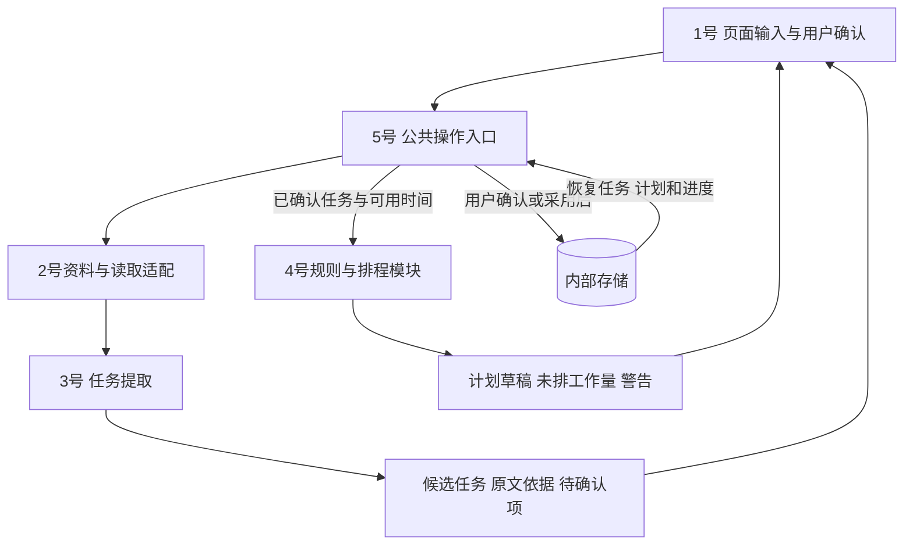

# 公共后端与集成 / Backend Integration

**分工：5号 · 设计版本：v0.1 · 更新日期：2026-10-08**

本模块连接资料导入、任务提取、用户确认、学习排程和保存恢复，为前端提供统一的操作入口。本文说明后端的设计、与其他模块的交接约定和后续验收标准，供全组协作开发使用。

**当前阶段：设计与交接。** 当前分支的 `src/`、`tests/` 仍是占位目录，尚无可启动的完整应用、公共后端或数据库。下文的函数、数据结构和存储方案均为待实现设计；现有数据与参考案例单独列明。

## 1. 模块范围与协作边界

核心流程是：**已有邮件资料 → 候选任务 → 用户确认 → 学习计划预览 → 用户采用 → 内部保存与后续重排。** 当前项目不接入 Canvas/LMS；Outlook、Teams 或日历的自动接入也不作为已实现功能。

| 协作模块 | 对方提供 | 5号负责的连接工作 |
| --- | --- | --- |
| 1号：前端界面 | 用户输入、修改、确认、采用计划和进度操作 | 提供操作入口，返回结果、待处理项、警告和保存状态 |
| 2号：数据与环境 | 邮件资料、字段说明、后续读取适配和环境说明 | 将现有CSV导入内部来源记录，校验格式、去重并保留来源信息 |
| 3号：任务提取 | 标注样例、候选任务、日期依据、重复或改期建议 | 适配候选结果，保存来源关联，应用用户确认后的修改 |
| 4号：学习计划 | 排程规则、输入输出约定、参考案例与约束检查 | 构建排程请求、适配返回结果、连接重排与保存；协作完成后端实现 |
| 6号：测试与评价 | 预期结果、独立测试资料、问题与复测记录 | 提供可检查的模块入口和集成版本，修复后端及连接问题 |

具体界面由1号设计，文本含义由3号判断，排程规则由4号维护。5号维护公共结构、调用顺序、配置、业务状态和存储。4号材料提出由5号协作编码初始排程；具体编码拆分需在开发前与4号对齐，沿用同一套规则。

## 2. 已有材料与当前状态

以下依据本地可见内容核对，未更新远端引用或切换分支。

| 材料 | 已具备的内容 | 仍待完成 |
| --- | --- | --- |
| [2号数据说明](../no2_datapreparation/README.md)与[核心CSV](../no2_datapreparation/Sprint1_核心10封_系统输入_交接版.csv) | 10条脱敏邮件摘录及9列字段；CSV结构可读取 | 导入团队应用、持久保存及集成检查 |
| [3号标注完成版](../no2_datapreparation/Sprint1_3号标注完成版.xlsx) | `标注对照_3号填写`中有4条非空任务标注 | 提取程序、用户确认流程及统一字段适配 |
| 4号分支 `origin/zhaozichen` 的 `github_upload/planner/` | 排程README、5组手排参考案例、检查器及保存的检查报告 | 自动排程、重排实现与应用集成 |
| 当前分支 `src/`、`tests/` | 目录占位 | 业务代码、存储、界面连接和实际测试 |

本次参考版本：当前分支 `huangpengyu` 的基础提交 `60f3fb2`；4号材料为本地 `origin/zhaozichen` 引用 `e4260bb`。4号目录尚未合入当前分支，因此本文用“分支＋路径”引用，不能按当前工作区文件直接运行。

4号保存的5/5检查结果针对**手排参考方案**，不代表自动排程或整套系统已经通过测试。根目录README仍保留早期五人分工；本文采用近期模块资料中的1—6号编号，聚焦5号公共后端职责。

## 3. 业务工作流

下图是待实现的调用关系；所有界面操作通过公共后端连接业务模块。



1. **导入资料：**读取CSV，保留邮件编号、日期背景和摘录类型，返回成功、重复及失败条目。
2. **提取候选：**调用提取模块，返回任务、日期候选、原文依据及不确定项。模型失败与“没有任务”分别反馈。
3. **用户确认：**用户核对日期和任务类型，补充预计剩余用时、优先级及空闲时间。缺信息的任务留在待处理列表，其他完整任务可继续。
4. **生成草稿：**组织排程请求，返回安排、未排入工作和警告。生成草稿不会替换当前采用的计划。
5. **采用与保存：**用户查看变更并采用后，再统一保存计划及关联信息；生成成功与保存成功分别显示。
6. **记录与重排：**记录实际完成量，保留锁定段；任务或可用时间变化后提示重排，用户采用新版本后替换当前计划。

## 4. 数据接入与公共约定

### 4.1 现有CSV的读取约定

实际输入位于 `no2_datapreparation/Sprint1_核心10封_系统输入_交接版.csv`。使用正规CSV读取器，如 Python `csv.DictReader`，采用 `encoding="utf-8-sig"`、`newline=""`；正文可能包含引号和换行，不能按逗号或换行自行拆分。

| 原字段 | 后端处理约定 |
| --- | --- |
| `record_id` | 保留稳定编号，不重新排序编号；结合数据批次标识识别同一来源 |
| `course_code`、`subject` | 保留课程与标题，用于展示、检索和来源核对 |
| `posted_at` | 当前10条均为空，内部记为未知，不用接收时间填成发件时间 |
| `received_at` | 保留带偏移量的接收时间，例如 `2026-08-11T21:18:18+08:00` |
| `timezone`、`academic_context` | 保留 `Asia/Singapore` 与学期背景，供日期解释使用 |
| `body_text`、`body_text_type` | 保留摘录正文与摘录说明，不标记为完整邮件 |

同一批次、同一编号、内容未变的重复导入应跳过。相同编号但内容变化时保留版本和差异，重新提取的结果先等待核对。跨邮件的同一任务或改期由3号提出关联建议，用户确认后由5号更新同一任务。

以接收日期解释“this Friday”等相对日期时，必须记录这是使用接收时间的假设并交用户核对。资料包含历史通知：固定测试时钟用于复现案例，实际运行按真实当前时间处理逾期，不能自动顺延原截止日期。

### 4.2 3号标注到内部任务的映射

Excel是人工对照资料；程序运行时，原始邮件文本与人工答案分开读取，人工答案不作为模型提取输入。

| 标注字段 | 内部使用方式 |
| --- | --- |
| `task_id` | 保留为标注参考编号；应用维护稳定的任务编号和关联映射 |
| `record_ids` | 解析为来源编号列表；一个任务可关联多封邮件 |
| `task_name`、`course_code` | 映射为任务名称和课程 |
| `deadline_date`、`deadline_time`、`timezone` | 共同构成截止时间候选；缺日期或时刻时保持待确认 |
| `evidence_text`、`resolution_basis` | 保留原文依据和日期解释理由 |
| `relation_or_event` | 作为任务合并、改期或事件类型的判断依据 |
| `status`、`annotator`、`reviewer` | 保留标注状态；不能据此直接设置用户已确认 |

已有交接案例必须保留以下含义：

- **T001：**S011、S005、S013是同一问卷的改期链，合并为一个任务并保留多个来源。
- **T002与T004：**T004补充T002的同一模拟考试任务；确认关联后更新同一任务，不增加第二个待办。T004仍缺具体时刻。
- **T003：**是到场事项，不等同于可拆分的复习任务；考试时段在信息完整后作为固定占用，复习工作量另行输入。

对缺失或相互矛盾的日期不默认补成23:59。用户核对前保留日期候选与问题；填写预计用时并确认后，才生成供排程使用的任务。

### 4.3 与4号排程模块对齐

排程接收结构化任务和时间区间，无需完整邮件正文或私人会议标题。所有时间带UTC偏移量，时区使用 `Asia/Singapore` 等IANA名称，区间采用 `[start, end)`。

| 请求项 | 约定 |
| --- | --- |
| `now`、`timezone` | 本次排程时钟和用户时区；测试显式固定 `now` |
| `tasks[]` | 每项含 `id`、`title`、`due_at`、`remaining_minutes`、`priority`、`confirmed` |
| `availability[]`、`busy[]` | 可用时段和课程、会议等固定占用，均使用 `start`、`end` |
| `completed_blocks[]` | 已完成学习段，保留实际发生时段并计入对应日期的学习量 |
| `locked_blocks[]` | 未来锁定学习段，包含 `task_id`、`start`、`end`，重排时保留 |
| `settings` | 学习窗口、日上限、时间粒度、休息和缓冲等统一配置 |

`remaining_minutes`是尚未完成的工作量，**包含未来锁定段**。已完成量已从剩余量中扣除；排程器再扣除未来锁定量，避免重复安排或重复扣减。

4号当前提议为：09:00—22:00、每日180分钟、15分钟粒度、单段30—90分钟、连续最多90分钟后至少休息15分钟，尽量提前24小时完成。24小时是软目标，合法安排缓冲不足时返回 `LOW_BUFFER`。这些是**待全组确认的模块默认值**，后端集中保存配置，不在不同页面分别写死。

返回结果沿用 `status`、`blocks[]`、`unscheduled[]`、`warnings[]`；`unscheduled`使用 `task_id` 和 `minutes`。缺口解释结合警告码展示。锁定结果保留 `retained_locked_blocks[]`。

4号README还提出 `task_results[]`，但现有参考JSON尚未包含该字段。后续需对齐逐任务汇总字段，并检查：

```text
新排分钟数 + 未来锁定分钟数 + 未排分钟数 = 取整后的剩余工作量
```

参考案例的 `settings`位于JSON顶层，适配时需连同单个案例的 `input`传给排程模块。`needs_input`案例的 `unscheduled`可以为空，因此待确认任务必须另行保留，不能只靠缺口列表判断是否遗漏任务。

## 5. 公共操作入口设计

首版采用Python内部分层，前端调用公共服务函数，SQLite负责本地保存。后续如需独立网页后端，可在同一组服务外增加HTTP接口。下表是拟定入口，当前尚未创建对应函数。

| 操作入口 | 主要输入 | 应返回或完成的结果 |
| --- | --- | --- |
| `import_sources` | CSV路径、数据批次标识 | 成功/重复/失败条目、内部来源编号 |
| `extract_candidates` | 来源编号，必要时附已有任务摘要 | 候选任务、原文依据、待确认项或提取错误 |
| `confirm_task` | 候选编号、用户修改、确认操作 | 保存后的任务与来源关联；缺必要信息时仍待处理 |
| `save_calendar` | 可用时段、固定占用、时区 | 保存结果；时段变化后将现有计划标记为需更新 |
| `generate_plan` | `now`、设置及当前任务/时间数据 | 计划草稿、排程状态、缺口、警告及所依据的数据版本 |
| `adopt_plan` | 草稿编号、预览时的数据版本 | 版本校验通过后采用并保存；数据已变更时提示重新生成 |
| `record_progress` | 学习段或任务编号、实际进度、唯一操作编号 | 更新完成记录与剩余量，重复提交同一操作不重复扣减 |
| `load_workspace` | 当前单用户工作区 | 恢复来源、任务、时间设置、计划与完成记录 |

操作返回统一包含成功与否、结果和错误信息，例如 `ok`、`data`、`error`；业务结果内保留自身状态与警告。界面据此区分输入不完整、模型调用失败、排程失败、数据已变化和保存失败。

**三个状态概念分别保存：**任务是否经用户确认、计划是否已采用、任务是否已完成。排程返回的 `status="complete"`只表示有效任务全部排入时间表，不表示没有警告、任务已经做完或计划已经保存。

## 6. 存储与更新规则

以下为逻辑数据划分，具体表结构在实现时细化。

| 保存内容 | 用途 |
| --- | --- |
| 来源记录及版本 | 保存原文、原始日期字段、来源编号和导入记录 |
| 候选任务及依据 | 保留模型或人工结果、待确认问题和更新建议 |
| 已确认任务与来源关联 | 统一任务编号、截止时间、剩余量和多来源关系 |
| 可用时段、固定占用与设置 | 为排程提供同一份时间输入和规则配置 |
| 计划版本与学习段 | 保存草稿/已采用/需更新状态、缺口、警告、设置和数据版本 |
| 完成与锁定记录 | 保留实际完成量、发生时段和未来锁定段，支持重排 |

- **任务更新：**用户确认后保存；新消息的改期建议先展示新旧差异。相关计划标记为需更新，不静默覆盖已有安排。
- **采用计划：**核对任务、进度、锁定段、可用/占用时段和设置的版本，并按当前运行时钟重新检查；草稿已有过时学习段时提示重新生成。校验通过后，在同一次数据库事务中保存计划、学习段和关联状态；保存失败时保留原采用计划。
- **进度更新：**唯一操作编号避免按钮重试造成重复扣减。同一事务中记录实际完成时段、更新剩余量，并移除或减少对应未来锁定部分；同一部分不能同时计入已完成量和未来锁定量。手动修正剩余用时记为估算调整，不伪造完成段。
- **重新排程：**只重排未完成、未锁定的部分；锁定段与新占用冲突时提示处理，不能自动移走锁定段。
- **配置与日志：**模型配置和密钥从本地配置读取；日志记录操作编号、状态和错误，避免写入完整私人正文或密钥。

## 7. 集成顺序与验收

### 7.1 实现顺序

1. **来源导入：**5号先接入2号现有CSV，验证稳定编号、多行正文、空值和时区，再实现保存与重复导入控制。
2. **候选与确认：**与3号对齐字段，以固定候选样例接通1号确认页面，随后替换为实际提取功能。样例模式在界面明确标注。
3. **计划与进度：**与4号确认参数及编码分工，接入排程请求、草稿预览、采用保存、完成记录与重排。
4. **完整验收：**6号按统一用例检查正常、失败和恢复路径；各模块修复本模块问题，5号处理公共后端与连接问题。

各功能使用独立分支和小步提交。公共字段变更先与使用方对齐，合并后检查受影响流程。本文仅提供协作约定，不代表这些合并或实现已经执行。

### 7.2 后续验收清单

下表均为待执行的验收标准，不是已通过的测试结果。

| 检查项 | 通过标准 |
| --- | --- |
| CSV导入 | 10条来源正确读取；原编号、中文、换行、时区和空 `posted_at`完整保留 |
| 重复与改期 | 重导同一来源不新增；同一任务改期保留来源链，用户确认后更新 |
| 标注适配 | T002/T004不重复建任务；缺具体时刻仍待确认，人工标注状态不冒充用户确认 |
| 排程前确认 | 日期、时区、剩余用时不完整的任务留在待处理列表；其他完整任务可继续 |
| 排程结果 | 无冲突、超载或截止后安排；缺口和缓冲警告可见，完整排入与完成任务状态分开 |
| 锁定与进度 | 完成量和锁定段在重排后保留，重复进度操作不重复扣减 |
| 草稿采用 | 预览不替换当前计划；数据变化后旧草稿不能直接采用 |
| 保存恢复 | 用户采用后可关闭重开恢复；保存失败保留原有效计划 |
| 模型或模块失败 | 界面收到明确错误，已有数据仍可查看，重试不会重复创建记录 |

4号参考案例用于开发对照，6号另准备独立评价资料；现有CSV和人工标注不能同时作为调试输入和未见过的评价证据。手排检查器的已有结果不替代新生成计划的检查。

## 8. 开发前需要对齐的事项

- 与1号：确认页面需要的结果字段、待确认提示、保存反馈，以及手动调整是否锁定学习段。
- 与2号、3号：确认来源与任务字段映射、缺时刻处理和多来源合并；保留原文件与原始标注，适配逻辑放在应用侧。
- 与4号：冻结首版配置，明确初始排程编码分工，补齐 `task_results`与锁定结果的返回格式。
- 与6号：确定验收输入和独立数据，按实际运行记录问题与复测结果。

本目录当前仅提供设计README。依赖清单、应用启动命令和数据库初始化方法将在对应代码实现并验证后补充。
